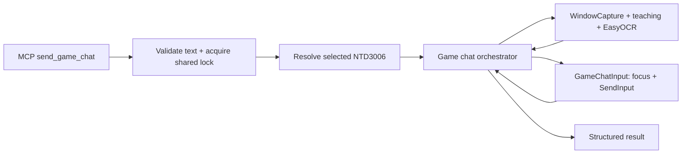

# Feature Design: MCP chat và command trong game

Trạng thái: thiết kế cập nhật sau thử trực tiếp NTD3006 theo yêu cầu user; chờ duyệt thay đổi kỹ thuật trước implementation.
Cơ sở: `requirements.md` đã được duyệt; review requirements `REV-20260917-085645` đã resolved.

## 1. Impact Analysis

### 1.1. Kết quả khảo sát code và cửa sổ thật

- `src/ai_control/servers/keyboard.py` đã có MCP server, chọn target theo PID/HWND và helper `_run_keyboard_action`. Tool mới đăng ký tại server này, không thêm server/process MCP.
- `AutoAction.text_input_enabled` có trong model và helper MCP. Tuy nhiên `SystemExecutor._execute_internal` hiện bỏ qua cờ này, strip `action.value`, rồi gửi cả chuỗi vào `_send_key_with_sendinput`. Helper đó xử lý tên phím/hotkey, không phải API nhập nguyên văn một câu. Không gọi helper này với toàn bộ text chat.
- `_send_key_with_sendinput` có cấu trúc Win32 INPUT, scan code và Unicode làm tài liệu tham khảo. Fallback sang `keyboard.press_and_release` không có kiểm tra kết quả nhập, nên không dùng fallback đó cho tool mới.
- `_run_companion_tool` hiện luôn wake bằng click nền `(1, 1)` trước action. Chat cần quan sát trạng thái ban đầu trước mọi click/phím; tool mới dùng wrapper riêng, tái sử dụng selection và cách gom stdout, không gọi wake click.
- `WindowCapture.capture` và EasyOCR tiếng Việt/Anh có sẵn. Capture có thể fallback sang ảnh màn hình, nên cần kiểm tra focus, kích thước, chất lượng frame và mẫu giao diện trước khi quyết định.
- `mainInfo.chatBox` trong teaching chỉ định nghĩa nút ChatBox; không dùng nó làm bằng chứng ô nhập đang mở.
- Khảo sát chỉ đọc ngày 2026-09-17: cửa sổ `MU GamethuVN - Season 21 (Golden - NTD3001)`, PID 13492, HWND 66958, client 800x600. Các số PID/HWND chỉ là bằng chứng phiên khảo sát, không ghi cứng vào implementation.
- EnumChildWindows ở thời điểm khảo sát chỉ thấy dialog/static/button ẩn, không có Edit control hiện hữu. Không dựa vào WM_GETTEXT hoặc UI Automation để đọc ô chat khi chưa có bằng chứng hỗ trợ.
- Ảnh khảo sát ban đầu: `build/runtime/game_chat_design/current.png` (ignored runtime artifact). Lúc chụp, Storage và Equip đang mở, chưa thấy ô nhập chat. Tại thời điểm khảo sát ban đầu chưa gửi phím/chat.
- User sau đó yêu cầu thử NTD3006 và tiếp tục với quyền Administrator. Đã thử mở, xóa, nhập Unicode và gửi câu mẫu thành công một lần; chi tiết tại `calibration.md`. Target hiện tại là NTD3006, không còn cố định NTD3001.

### 1.2. Files và API bị ảnh hưởng

| File                                         | Thay đổi dự kiến                                                         |
|----------------------------------------------|--------------------------------------------------------------------------|
| src/logic/game_chat.py                       | Mới: đọc teaching, nhận diện/OCR và điều phối chuỗi thao tác             |
| src/logic/system_executor/game_chat_input.py | Mới: focus có xác nhận, phím/hotkey và nhập text Unicode qua SendInput   |
| src/ai_control/servers/keyboard.py           | Đăng ký send_game_chat; wrapper không wake click; khóa thao tác MCP      |
| mcp/config/mu_game_window.json               | Bổ sung section gameChat tách biệt nút mainInfo.chatBox                  |
| mcp/config/assets/game_chat_*.png            | Mới: mẫu khung nhập mở/đóng/trống được thu thập khi kiểm thử             |
| tests/test_game_chat.py                      | Mới: hành vi điều phối, nhận diện ảnh, OCR và các lỗi                    |
| tests/test_game_chat_input.py                | Mới: cấu trúc/chuỗi input, Unicode, focus và lỗi gửi phím                |
| tests/test_mcp_keyboard_server.py            | Thêm tool vào catalog và kiểm tra target, wrapper, serialization         |
| tests/fixtures/game_chat/                    | Mới: ảnh nhỏ có provenance phục vụ test nhận diện/OCR thật               |
| docs/MANUAL_TEST_GAME_CHAT_MCP.md            | Mới: kiểm thử 3 trạng thái, tiếng Việt, giới hạn và gửi đúng một lần     |
| mcp/README.md                                | Mô tả tool, chọn NTD3006, foreground requirement và mức xác nhận kết quả |

Các đường dẫn mới trong bảng chưa được tạo ở bước design. Không sửa hành vi nhập text của AutoAction trong feature này. Không thay đổi tên/schema của các tool hiện hữu. Khóa wrapper chỉ tuần tự hóa lời gọi, giữ nguyên kết quả/wake của tool cũ.

### 1.3. Dependencies

- Thư viện đã có: ctypes, threading, time, unicodedata, dataclasses, pywin32, numpy, opencv-python, EasyOCR, MCP SDK.
- Dùng trực tiếp `src.logic.system_executor.window_capture.WindowCapture` và reader `EasyOCREngine` đang cấu hình `['vi', 'en']`.
- Không thêm package; không thêm dependency PyQt vào logic.
- Adapter input tham khảo cấu trúc SendInput hiện có nhưng giữ API riêng cho literal text, không mở rộng `SystemExecutor` lớn.

### 1.4. Rủi ro và cách xử lý

| Rủi ro                                    | Xử lý trong thiết kế                                                      |
|-------------------------------------------|---------------------------------------------------------------------------|
| Enter mở vô tình gửi text cũ              | Chỉ mở khi CLOSED có bằng chứng; UNKNOWN dừng trước phím                  |
| OCR không đọc được bị hiểu thành ô trống  | EMPTY cần bằng chứng ảnh riêng; OCR rỗng chỉ là UNKNOWN                   |
| End + Shift+Home không được game hỗ trợ   | Kiểm chứng khi calibration; xóa xong bắt buộc verify trống                |
| Game bỏ dấu hoặc không nhận Unicode       | Verify nội dung trước Enter; không bỏ dấu hoặc đổi backend âm thầm        |
| Focus thay đổi khi đang nhập              | Kiểm tra trước/sau từng batch; dừng, giữ submit_state phù hợp             |
| Input API chỉ gửi được một phần           | Không retry batch; nhả modifier đã giữ, báo lỗi                           |
| OCR/capture lỗi sau Enter cuối            | submit_state=unknown; không gửi lại                                       |
| Các MCP call xen kẽ                       | Khóa chung wrapper của game MCP trong một server, giữ xuyên suốt thao tác |
| Text dài bị game cắt/ngang vùng nhìn thấy | Không gửi khi không đối chiếu được toàn bộ nội dung                       |
| Độ phân giải/teaching không hợp lệ        | Từ chối trước input; ban đầu hỗ trợ client 800x600 theo profile hiện tại  |

## 2. Technical Design

### 2.1. API và chọn target

```python
send_game_chat(text: str) -> dict[str, Any]
```

- MCP lấy cửa sổ từ lựa chọn hiện có trên Gemini Chat thông qua `_selected_visible_windows()`; user chọn NTD3006 một lần bằng UI đang có.
- Tool kiểm tra tên nhân vật ở cuối window title là chính xác `NTD3006`, cùng prefix game trong profile. Không dùng substring dễ khớp NTD30060. Chọn sai/thiếu target trả `selection_required=true` trước bất kỳ input nào.
- Trong phạm vi đã duyệt, không thêm tham số target do AI tự chọn và không tự ghi lại selected_process.json.
- Chụp snapshot PID/HWND/creation identity ở đầu; kiểm tra window ownership và title trước từng bước input. Selection thay đổi không làm chuyển target giữa lời gọi.
- Validation text: phải là str, không rỗng/whitespace-only, không CR/LF/tab/NUL hoặc control characters, không lone surrogate. Giới hạn bảo vệ API là 500 Python characters, theo helper MCP hiện có; đây không phải khẳng định giới hạn game. Không strip/lower text gửi.
- Text trong giới hạn API vẫn phải đọc lại được đầy đủ trước gửi. Nếu game cắt ngắn, cuộn khiến không đọc hết, hoặc không hỗ trợ ký tự thì trả lỗi, không gửi.
- Focus NTD3006 bằng SetForegroundWindow và xác nhận GetForegroundWindow. Nếu bị từ chối, dùng AttachThreadInput giữa thread hiện tại/foreground/target như luồng `_click_client` hiện có, detach trong finally rồi xác nhận lại. Không click nội dung game, không giả lập Alt. Vẫn không focus được thì trả `focus_failed`. Giữ game foreground khi hoàn tất.

Ví dụ gọi: `send_game_chat(text="Xin anh em nhường bãi")`.

### 2.2. Architecture và luồng



Thứ tự thực thi:

1. Validate text, acquire shared lock và resolve target. Nạp/validate teaching, template, reader trước input. Lỗi teaching/OCR không làm thay đổi game.
2. Focus target và xác nhận identity; capture fresh frame. Không wake click. Require client 800x600, frame không rỗng/đen/đồng màu và nhận diện được vùng HUD/ô chat theo teaching.
3. Đọc trạng thái chat trên ít nhất hai frame mới. CLOSED: Enter mở đúng một lần, rồi poll đến OPEN trong 2 giây; không retry Enter. OPEN: bỏ qua Enter mở. UNKNOWN: dừng.
4. Đọc ô nhập. EMPTY: tiếp tục. NONEMPTY: gửi End → Shift+Home → Backspace, verify EMPTY trong 2 giây. Đây là tổ hợp đã thử thành công trên NTD3006; Ctrl+A → Backspace không xóa được trong cùng phiên thử. UNKNOWN: dừng.
5. Nhập text bằng Unicode SendInput, tách theo UTF-16 code point boundaries; mỗi code unit có down/up, nghỉ 35 ms giữa các Python characters như lần thử thành công. Kiểm tra số event đã nhận và target/focus trước/sau từng character. Không truyền text cho hotkey parser. Chưa tối ưu batch khi chưa có dữ liệu kiểm thử.
6. Capture/OCR tới khi hai kết quả liên tiếp khớp nội dung kỳ vọng, tối đa 3 giây sau hoàn tất nhập. So sánh Unicode NFC, phân biệt hoa thường, dấu và ký hiệu command. Không fuzzy match hay bỏ dấu. Khoảng trắng chỉ được tái dựng từ OCR bounding boxes; nếu không xác định được chính xác thì mismatch, không tự nới điều kiện.
7. Ngay trước gửi: kiểm tra focus, identity, OPEN và text lần cuối. Đặt `submit_attempted=true` trước khi gọi Enter để exception/partial input không bị báo nhầm là chưa từng thử gửi. Enter cuối có một down, giữ 100 ms rồi một up như lần thử thành công, không có retry.
8. Quan sát tối đa 2 giây. Chỉ `submit_state=submitted` nếu Enter đã được chèn đủ event và khung chuyển OPEN có text sang CLOSED hoặc OPEN+EMPTY qua hai frame. Nếu chưa xác minh được, `submit_state=unknown`, `success=false`.
9. Nhả modifier do tool giữ và lock trong finally. Không Enter/Escape/clear tự động khi cleanup; giữ bằng chứng và text hiện tại nếu lỗi.

Timeout là giới hạn poll; thời gian một lượt OCR thực tế có thể vượt khoảng poll. MCP giữ timeout hiện có, và test hiệu năng sẽ xác nhận đủ cho cold start reader. Không hứa thời gian hoàn tất cố định trước khi đo.

### 2.3. Nhận diện và teaching

Thêm `gameChat` tại root `mcp/config/mu_game_window.json`, không sửa nghĩa của `mainInfo.chatBox`:

| Field                    | Vai trò                                                        |
|--------------------------|----------------------------------------------------------------|
| targetCharacter          | NTD3006                                                        |
| referenceClientSize      | width=800, height=600                                          |
| stateRoi                 | Vùng giao diện cố định phân biệt khung mở/đóng                 |
| stateTemplates.open      | Path, threshold cho viền/anchor khung mở, không chứa text động |
| stateTemplates.closed    | Path, threshold cho dấu hiệu giao diện khi đóng                |
| minimumScoreMargin       | Chênh lệch tối thiểu giữa hai mẫu để tránh đoán trạng thái     |
| inputRoiRelativeToAnchor | Chỉ vùng nhập text, loại prefix kênh/chat history              |
| emptyInputTemplate       | Mẫu ô trống, có chỉ dẫn loại caret đã được kiểm chứng          |
| emptyDifferenceThreshold | Ngưỡng residual với ô trống sau chuẩn hóa nền/caret            |
| textRecognition          | scale, padding, minimumConfidence, engine=easyocr              |
| clearShortcut            | end → shift+home → backspace; đã thử thành công trên NTD3006   |
| stableFrames             | 2 frame nhất quán cho state và verify text                     |

- Mẫu OPEN và CLOSED phải có đặc trưng tĩnh, không chỉ chụp vùng đất/nhân vật đang chuyển động. Chỉ kết luận khi một mẫu vượt threshold và margin, mẫu kia không mâu thuẫn. Thiếu mẫu hoặc cả hai cùng match là UNKNOWN.
- Ô trống có placeholder màu xanh `Enter chat content`, nên không đồng nghĩa OCR rỗng. Mẫu EMPTY phải chứa placeholder đã quan sát; phân biệt text user trùng câu placeholder bằng màu và template, không chỉ so chuỗi OCR. Caret phải được định vị bằng đặc điểm/nhấp nháy đã đo, không mask cố định cả một dải có thể che ký tự.
- NONEMPTY cần glyph residual ngoài placeholder/caret hoặc OCR text user đáng tin. EMPTY cần placeholder đúng mẫu/màu và không có thêm glyph user qua các frame. OCR không thấy chữ không đủ để kết luận EMPTY.
- Crop OCR đã thử: x=16..319, y=560..580, padding đen 6 pixel, scale 4. Hai frame không có caret đọc đúng câu mẫu với confidence khoảng 0.6081 và 0.6095. Detection nhiễu ngoài dòng có confidence khoảng 0.028 phải được loại theo vị trí/confidence. Đây là thông số khởi đầu cho tests, chưa coi một câu mẫu là đủ chốt threshold tổng quát.
- Nếu teaching không tìm được đặc trưng ổn định cho CLOSED/EMPTY, báo giới hạn và điều chỉnh design trước implementation; không thay bằng việc nhấn Enter mù.
- Đường dẫn asset resolve từ thư mục chứa teaching (`mcp/config`), thống nhất với path `assets/...` trong section mới. Không thay path resolution của teaching cũ.
- Tọa độ crop khởi đầu lấy từ lần thử thật trong `calibration.md`; threshold và mẫu phân loại tổng quát tiếp tục được xác minh bằng fixture. Không đưa tọa độ đoán vào code/config. Config được đọc đầu mỗi call; kiểm tra schema, ROI bounds, threshold range và độ biến thiên template trước input.
- Chưa thêm setting UI hoặc field AutoAction. Test round trip JSON và load lại sau khởi động lại đủ cho persistence của teaching.

### 2.4. Input adapter

- File mới `game_chat_input.py` giữ Win32 INPUT layout tương thích x86/x64, scan-code key events và Unicode text events. Có key marker `0xAB10` như action hiện có.
- API literal text đi riêng, kể cả chuỗi chứa `+`, `enter`, `/` hoặc ký hiệu command; không diễn giải chúng thành hotkey.
- Unicode được mã hóa UTF-16 LE với đầy đủ surrogate pairs. Chỉ áp dụng scan code cho Enter, End, Shift, Home, Backspace; End/Home cần extended-key flag. Không dùng keyboard layout để biến text tiếng Việt thành hotkey.
- Các phím điều khiển giữ 100 ms, nghỉ ít nhất 70 ms giữa phím; Shift giữ xuyên suốt Home rồi nhả trước Backspace. Đây là timing đã thử, không phải thời gian tối thiểu được bảo đảm. Nhả modifier do tool giữ ngay cả khi mất focus; việc cleanup không được bị chặn bởi guard foreground.
- Trước input, nếu Ctrl/Alt/Shift/Win đang bị người dùng giữ thì dừng `input_busy`; không tự nhả phím người dùng. Theo dõi và nhả các modifier do tool giữ trong finally khi lỗi.
- End + Shift+Home và Backspace phải tác động đến ô chat đã nhận diện. Nếu chat mất focus dù game vẫn foreground, kiểm chứng trống/text sẽ thất bại và tool dừng trước gửi.
- Kết quả SendInput là số event chèn vào input stream, không chứng minh text đã đến game. Kiểm tra OCR sau input vẫn bắt buộc. [Microsoft SendInput](https://learn.microsoft.com/en-us/windows/win32/api/winuser/nf-winuser-sendinput).
- KEYEVENTF_UNICODE gửi tới foreground application. Game có thể không xử lý đúng nên cần live test. [Microsoft KEYBDINPUT](https://learn.microsoft.com/en-us/windows/win32/api/winuser/ns-winuser-keybdinput).
- SetForegroundWindow có thể bị Windows từ chối; tool phải xác nhận focus thay vì giả định thành công. [Microsoft SetForegroundWindow](https://learn.microsoft.com/en-us/windows/win32/api/winuser/nf-winuser-setforegroundwindow).

### 2.5. Đồng thời và tích hợp MCP

- `_GAME_ACTION_LOCK = threading.RLock()` ở server: cả wrapper hiện có và wrapper chat giữ lock từ selection đến kết quả, bao gồm capture, wake (tool cũ) và toàn bộ input. Điều này tránh tool khác trong cùng server xen giữa xóa/nhập/gửi.
- `ScenarioToolClient` đã có `_TARGETED_TOOL_CALL_LOCK` để gắn selection với lời gọi. Giữ nguyên lớp bảo vệ này.
- Phạm vi bảo vệ là một app/MCP server đang chạy. Không điều phối phần mềm automation khác hay thao tác người dùng. Live test cần dừng action bàn phím khác; thay đổi target/focus/state phát hiện được sẽ trả lỗi. Không tuyên bố loại bỏ hoàn toàn race ở mức hệ điều hành.
- Wrapper chat dùng redirect_stdout như wrapper cũ để log thư viện không phá stdio MCP. Không log toàn bộ text vào debug log; kết quả trả `text` cho caller khi cần đối chiếu.
- Kết quả lỗi xác định target dùng `selection_required=true`; nhận diện/nhập/gửi lỗi sau khi đã chọn đúng dùng false.
- Không cập nhật QWidget trực tiếp; bridge UI hiện có nhận kết quả, dùng signals theo cơ chế sẵn có.

### 2.6. Contract kết quả

```json
{
  "success": true,
  "selection_required": false,
  "stage": "complete",
  "target": {"hwnd": 66958, "title": "MU GamethuVN - Season 21 (Golden - NTD3006)"},
  "text": "Xin anh em nhường bãi",
  "chat_already_open": false,
  "had_existing_text": false,
  "cleared": false,
  "text_verified": true,
  "submit_attempted": true,
  "enter_sent": true,
  "submit_state": "submitted",
  "verification": {"method": "template_and_ocr", "post_chat_state": "closed"}
}
```

Ví dụ chỉ minh họa schema, không phải kết quả live test. `submitted` là xác nhận thao tác Enter cùng thay đổi giao diện, không phải server acknowledgement hoặc kết quả nghiệp vụ command.

- `submit_state`: `not_attempted` trước khi gọi Enter cuối; `submitted` khi đủ bằng chứng UI; `unknown` khi đã thử gửi nhưng chưa đủ bằng chứng.
- `enter_sent`: true chỉ khi adapter nhận đủ down/up; false trước input; null nếu partial/exception không biết đủ input.
- Khi lỗi thêm `error_code`, `error`; `stage` giữ bước thất bại: validate, select_target, load_teaching, focus, detect_chat, open_chat, clear_chat, type_text, verify_text, submit, verify_submit.
- Các field trạng thái chưa quan sát có giá trị null, không thay bằng false. `success=true` chỉ khi hoàn tất contract ở mức UI nói trên.

## 3. Code Skeleton

Skeleton chỉ nằm trong tài liệu; chưa tạo code implementation.

```python
# src/logic/game_chat.py
from dataclasses import dataclass
from pathlib import Path
from typing import Any, Literal

import numpy as np


@dataclass(frozen=True)
class ChatObservation:
    """Represent observed chat state without turning uncertainty into empty text."""

    state: Literal["closed", "open", "unknown"]
    content_state: Literal["empty", "nonempty", "unknown"]
    text: str | None
    evidence: dict[str, Any]


def validate_chat_text(text: str) -> None:
    """Validate a single literal message without mutating its contents."""
    ...


def observe_chat(image: np.ndarray, teaching: dict[str, Any], reader: Any) -> ChatObservation:
    """Classify one frame using taught state and input regions."""
    ...


def send_game_chat(target: dict[str, Any], text: str, *, teaching_path: Path) -> dict[str, Any]:
    """Prepare chat, verify literal text, and submit once on the pinned target."""
    ...
```

```python
# src/logic/system_executor/game_chat_input.py
class GameChatInput:
    """Deliver checked keyboard input to one foreground game window."""

    def __init__(self, hwnd: int, expected_pid: int, expected_title: str) -> None:
        ...

    def focus(self) -> None:
        """Focus and verify the pinned target or raise an input error."""
        ...

    def press_enter(self) -> None:
        """Insert exactly one Enter down/up sequence without retry."""
        ...

    def clear_text(self) -> None:
        """Select all and delete using the calibrated shortcut."""
        ...

    def type_text(self, text: str) -> None:
        """Insert literal UTF-16 text with target checks and event-count checks."""
        ...

    def release_owned_modifiers(self) -> None:
        """Release only modifiers held by this adapter."""
        ...
```

```python
# src/ai_control/servers/keyboard.py
@mcp.tool()
def send_game_chat(text: str) -> dict[str, Any]:
    """Replace the NTD3006 chat input with literal text and press Enter once."""
    ...
```

Không cần builder/factory hoặc hệ thống backend mở rộng: một orchestrator, một adapter input, các hàm nhận diện đơn giản. Test thay thế dependency Win32/capture/OCR khi cần, không mock orchestrator đang được test.

## 4. Kế hoạch xác minh trước implementation

Sau khi design được duyệt, bước tests sẽ:

1. Đã có ảnh đóng/mở trống/mở có text trên NTD3006 trong thư mục runtime. Chuyển các crop cần thiết thành fixture có provenance, DPI và client size cho tests tự động.
2. Đã thử thành công Enter mở, End → Shift+Home → Backspace xóa hết, Unicode hiển thị đúng và Enter gửi một lần theo yêu cầu thử trực tiếp của user. Viết tests hồi quy cho các hành vi này; không coi script chẩn đoán là implementation MCP.
3. Test nhận diện bằng ảnh thật với biến thể caret/overlay, và test UNKNOWN bằng ảnh không liên quan/đen/sai kích thước. Test OCR thật với câu ví dụ có dấu; không chỉ mock OCR để kết luận hỗ trợ tiếng Việt.
4. Unit test đủ ba trạng thái ban đầu, số Enter mở/gửi, lỗi partial input/focus/cửa sổ đổi, text có `+`, non-BMP, mismatch, timeout sau gửi không retry và hai call tuần tự.
5. Integration test catalog MCP, target NTD3006, lỗi selection, teaching reload và wrapper không wake click; regression wrapper tool hiện có và lock release sau exception.
6. Manual test gửi câu ví dụ sau khi implementation hoàn tất và user duyệt bước tests. Command chỉ test khi user cung cấp command cụ thể.

Giới hạn hiện tại: đã có bằng chứng thao tác và gửi câu ví dụ, nhưng chưa có bộ template/threshold tổng quát, tests tự động hoặc MCP tool hoàn chỉnh. Command cụ thể, text dài, Unicode khác và tình huống lỗi còn cần kiểm thử. Không coi thử thành công một câu là hoàn thành feature.
