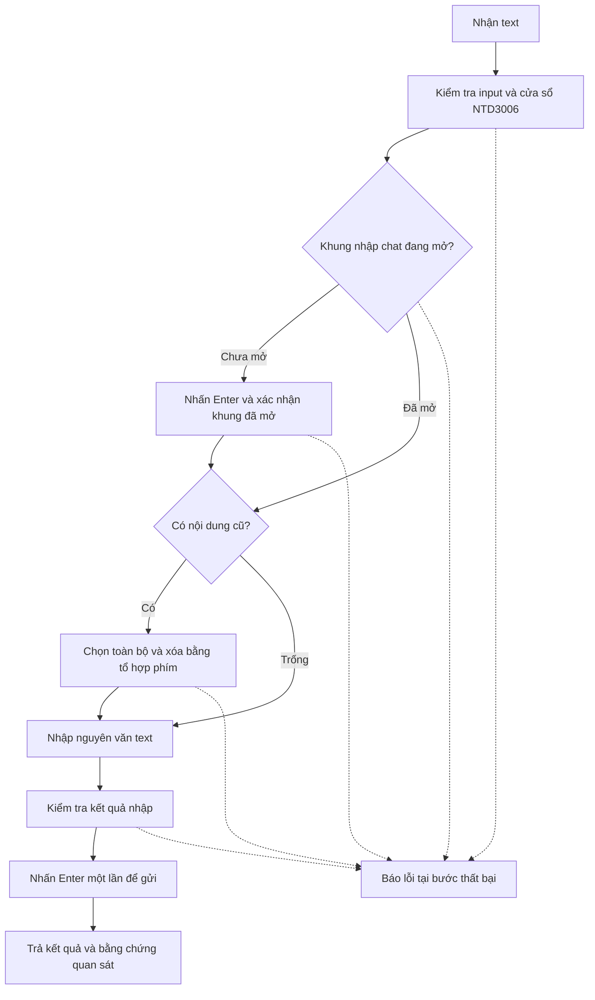

# MCP chat và command trong game

Trạng thái: user đã duyệt yêu cầu trong hội thoại ngày 2026-09-17.
Cập nhật: user chuyển cửa sổ thử từ NTD3001 sang NTD3006; target hiện tại là NTD3006.
Phạm vi: một MCP tool thực hiện trọn luồng nhập và gửi một tin nhắn hoặc command.

## 1. SPEC (Đặc tả)

**Vấn đề:** AI cần gửi chuỗi do người dùng cung cấp vào game, trong khi khung nhập chat có thể đang đóng, đang mở nhưng trống, hoặc đang chứa nội dung cũ.

**Mục tiêu:** Tham khảo action bàn phím/nhập chuỗi của Auto hiện tại để tạo MCP tool nhận text, chuẩn bị khung chat, thay nội dung cũ và nhấn Enter gửi đúng một lần trên cửa sổ NTD3006.

**Input/Output:**

| Loại   | Mô tả                                               | Ví dụ                               |
|--------|-----------------------------------------------------|-------------------------------------|
| Input  | Chuỗi chat hoặc command nguyên văn do user cung cấp | Xin anh em nhường bãi               |
| Target | Cửa sổ game có nhân vật NTD3006                     | MU GamethuVN ... (Golden - NTD3006) |
| Output | Kết quả từng bước, cửa sổ đích và trạng thái gửi    | Đã nhập text và nhấn Enter gửi      |
| Lỗi    | Bước thất bại và lý do, trạng thái gửi nếu chưa rõ  | Không xác định được khung nhập chat |

**Parameters (Tham số):**

| Tham số | Kiểu | Mô tả                                  | Giá trị mặc định |
|---------|------|----------------------------------------|------------------|
| text    | str  | Nội dung một tin nhắn hoặc một command | Bắt buộc         |

Cửa sổ sử dụng trong phạm vi yêu cầu là NTD3006. Cách liên kết với lựa chọn cửa sổ hiện có của ứng dụng được chốt trong design. Không tự chuyển sang một cửa sổ khác nếu không tìm thấy NTD3006.

Ví dụ người dùng nói `chat "Xin anh em nhường bãi"`: AI truyền `text="Xin anh em nhường bãi"`; phần diễn đạt `chat` và dấu ngoặc kép bao ngoài không thuộc nội dung gửi. MCP giữ nguyên text nhận được, không tự phân tích lại câu yêu cầu.

## 2. SƠ ĐỒ HOẠT ĐỘNG

## 3. MÔ TẢ HOẠT ĐỘNG

### 3.1. Luồng chính

1. **Nhận yêu cầu và xác định cửa sổ**
   - Input: text và thông tin cửa sổ game hiện tại.
   - Xử lý: kiểm tra nội dung hợp lệ; xác định duy nhất cửa sổ NTD3006.
   - Output: nội dung cần gửi và cửa sổ đích đã xác nhận.
2. **Chuẩn bị khung chat**
   - Input: hình ảnh/trạng thái hiện tại của đúng cửa sổ đích.
   - Xử lý: xác định khung nhập đã mở hay chưa; chỉ nhấn Enter mở khi xác nhận đang đóng. Kiểm tra lại sau khi mở.
   - Output: khung chat đang mở; không gửi nội dung cũ trong bước mở.
3. **Xóa nội dung cũ**
   - Input: khung nhập đang mở và trạng thái có text/trống.
   - Xử lý: nếu có text, dùng tổ hợp chọn toàn bộ và xóa nhanh; xác nhận đã sạch. Tổ hợp cụ thể cần kiểm chứng game hỗ trợ.
   - Output: ô nhập trống và sẵn sàng nhận nội dung mới.
4. **Nhập nội dung**
   - Input: text nguyên văn, gồm chữ hoa/thường, dấu tiếng Việt và ký hiệu command.
   - Xử lý: nhập chuỗi, kiểm tra việc nhập trước khi gửi; không âm thầm đổi dấu, sửa command hoặc cắt ngắn chuỗi.
   - Output: nội dung mới trong ô chat hoặc lỗi nhập text.
5. **Gửi và trả kết quả**
   - Input: nội dung mới đã nhập thành công.
   - Xử lý: nhấn Enter một lần để gửi/thực thi; ghi nhận bằng chứng sau thao tác.
   - Output: kết quả gồm cửa sổ đích, bước hoàn tất/thất bại và mức xác nhận gửi. Việc nhấn Enter thành công không tự chứng minh server đã thực thi command.

### 3.2. Các trường hợp ngoại lệ (Edge Cases)

- Khung chat đã mở: bỏ qua Enter mở; tránh gửi nhầm text cũ.
- Khung đã mở và trống: nhập trực tiếp.
- Không nhận diện được trạng thái chat hoặc ô bị che: báo lỗi thay vì coi là đang đóng/trống.
- Có nhiều cửa sổ game: chỉ thao tác trên NTD3006 đã xác định duy nhất.
- Cửa sổ bị đóng/đổi nhân vật trong khi chạy: dừng tại bước hiện tại.
- Text rỗng, chỉ có khoảng trắng, nhiều dòng hoặc vượt giới hạn game: từ chối trước thao tác; giới hạn cụ thể được xác định trong design/kiểm thử thực tế.
- Game không nhập đúng tiếng Việt hoặc không hỗ trợ tổ hợp xóa: báo lỗi, không gửi nội dung chưa kiểm chứng.
- Sau Enter gửi mà bằng chứng chưa đủ: trả trạng thái chưa xác nhận, không tự nhấn Enter gửi lại.
- Các lời gọi cùng cửa sổ phải được thực hiện tuần tự để nội dung không bị trộn.

### 3.3. Xử lý lỗi (Error Handling)

- Trả lỗi có bước cụ thể: xác định cửa sổ, nhận diện, mở chat, xóa, nhập hoặc gửi.
- Lỗi trước khi gửi: không nhấn Enter cuối cùng.
- Lỗi sau khi đã thử gửi: phân biệt với chưa gửi; không tự lặp lại một command.
- Độ tin cậy OCR thấp không đồng nghĩa ô nhập trống.
- Chỉ kết luận ở mức bằng chứng thu được; không khẳng định tác động command trong game nếu chỉ xác nhận thao tác bàn phím.

## 4. PHÁC THẢO UI (nếu có)

Không thêm màn hình hoặc setting UI. Tool được gọi qua MCP hiện có. Kết quả được trả về ứng dụng theo cơ chế hiện có; nếu cập nhật UI từ background thread, dùng signal/queued connection.

Text là dữ liệu của từng lời gọi, không lưu thành setting. Cấu hình nhận diện khung chat, nếu cần bổ sung, nằm cùng cấu hình teaching hiện có và phải đọc lại được sau khi khởi động lại. Không thay đổi serialization của AutoAction chỉ để thêm tool này.

## 5. TIÊU CHÍ NGHIỆM THU

- Kiểm chứng ba trạng thái ban đầu: đóng, mở trống, mở có text.
- Text cũ không bị gửi; text mới được nhập chính xác và Enter cuối chỉ được gửi một lần.
- Kiểm chứng câu `Xin anh em nhường bãi` trên NTD3006 và một command do user chỉ định cho kiểm thử.
- Không sử dụng command làm thay đổi tài sản hoặc trạng thái game để thử nghiệm khi user chưa chỉ định.
- Các lỗi target, nhận diện, xóa, nhập và trạng thái gửi chưa xác nhận có kết quả phân biệt được.
- Các MCP tool hiện có tiếp tục hoạt động và tool mới xuất hiện trong danh mục MCP.

## 6. CƠ SỞ KHẢO SÁT VÀ PHẦN CẦN KIỂM CHỨNG

- Đã tìm thấy `src/ai_control/servers/keyboard.py`, cấu hình `mcp/config/mu_game_window.json` và các luồng capture/verify dialog hiện có.
- Cấu hình `mainInfo.chatBox` hiện chỉ mô tả nút ChatBox, không đủ chứng minh trạng thái ô nhập được mở bằng Enter.
- Có `text_input_enabled` trong model/helper MCP, nhưng cần kiểm tra đường thực thi thực tế trước khi quyết định tái sử dụng.
- Đã thử trực tiếp trên NTD3006 sau bước requirements: End → Shift+Home → Backspace xóa được text, Unicode nhập được câu mẫu và Enter gửi thành công một lần. Chi tiết và giới hạn nằm trong `calibration.md`; chưa phải kết quả của MCP tool hoàn chỉnh.
